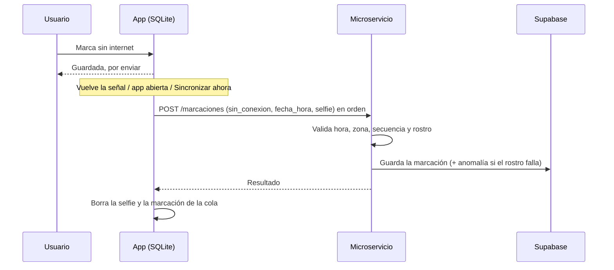

# Flujo del sistema — lógica de negocio y tecnologías

Documento pensado para explicar a la directora de tesis cómo funciona el sistema completo, paso a paso, y qué tecnología interviene en cada momento.

## Componentes (resumen rápido)

| Componente | Tecnología | Rol en el sistema |
|---|---|---|
| App móvil | React Native + Expo | Canal principal del Usuario |
| Web (una sola app) | React + Tailwind + Recharts | `/admin`: panel del Administrador · `/usuario`: contingencia del Usuario |
| Base de datos | Supabase (PostgreSQL) | Fuente única de verdad, compartida por todos (los rostros se guardan cifrados y solo los lee el microservicio) |
| Almacenamiento local | SQLite (`expo-sqlite`) | Cola temporal de marcaciones sin conexión, solo dentro del celular; la selfie se guarda cifrada (AES-256-GCM) |
| Microservicio | Python + FastAPI + ONNX | Verifica el rostro y que sea una cara real, valida reglas, detecta anomalías y escribe los datos |
| IA generativa | OpenAI API (`gpt-4.1-mini`) | Redacta alertas y conduce el chat de justificación |
| Hosting microservicio | Render | Aloja el microservicio |
| Hosting web | Vercel / Netlify | Aloja la web |

**Principio:** los clientes (app y web) solo **leen** de Supabase. Todo lo que se **escribe** (marcaciones, anomalías, justificaciones, chat) pasa por el microservicio, porque ahí se verifica el rostro y se aplican las reglas; el celular o el navegador no son de confianza.

---

## Flujo 0 — Registro del rostro (una sola vez)

1. El Administrador da de alta al Usuario en `/admin` (nombres, apellidos, correo, rol, sede y jornada; **sin contraseña**). El microservicio crea la cuenta en Supabase Auth, guarda al usuario en `usuarios` y Supabase envía un correo de invitación.
2. El Usuario abre el enlace, **crea su propia contraseña** en la web (`/aceptar-invitacion`) e inicia sesión en la app; si la olvida, usa «Olvidé mi contraseña» y recibe un enlace por correo. Luego vincula su dispositivo y lee y acepta el **consentimiento de datos biométricos** (LOPDP). *(App móvil)*
3. La app guía al Usuario para tomar 3 a 5 fotos (frente y giros leves de la cara) con `expo-camera` y las envía al microservicio.
4. El microservicio comprueba que sean caras reales (detección de vida pasiva), calcula un vector por foto, los **cifra con AES-256-GCM** y los guarda en la tabla `rostros` (a la que ningún cliente tiene acceso), junto con la fecha de consentimiento. **Las fotos no se guardan.**
5. Si cambia su apariencia o hubo un error, el Administrador resetea el rostro (se borra el rostro cifrado y el consentimiento) y se repite el proceso. Si el Usuario se desactiva, su rostro se borra automáticamente.

## Flujo 1 — Registro de asistencia (con conexión)

1. El Usuario presiona "Marcar asistencia" y la app valida su ubicación (`expo-location`) y toma una selfie (`expo-camera`).
2. La app envía al microservicio: tipo (`ingreso`, `salida_almuerzo`, `entrada_almuerzo` o `salida`, según la secuencia del día), ubicación, hora, selfie y un UUID generado en el celular.
3. El microservicio comprueba que la selfie sea una cara real (no una foto ni una pantalla), la compara con los vectores guardados (los descifra en memoria solo para comparar), valida que esté dentro de un bloque de su sede (o de la sede, si no tiene bloques registrados) y que no sea una marcación duplicada.
4. Si todo es válido, guarda la marcación en Supabase con `verificacion = 'verificada'` y el bloque donde se hizo, y la app muestra "Marcación registrada".
5. Si el rostro no coincide, **no se registra la marcación**: se crea una anomalía `verificacion_fallida` y la app permite reintentar.

## Flujo 2 — Sin conexión y sincronización (verificación diferida)

1. Sin internet, la app guarda la marcación (con selfie, ubicación y la hora del celular) en SQLite, con su UUID, en una carpeta privada del celular. El Usuario ve «Ingreso guardado» (o «Salida guardada», etc.) y la marcación aparece en el inicio y en el historial como «Por enviar».
2. `NetInfo` detecta que volvió la señal (también se intenta al abrir la app, cada minuto mientras está abierta y con el botón «Sincronizar ahora»).
3. La app envía los pendientes al microservicio **en orden cronológico**, uno por uno, con el mismo UUID (si algo se corta a mitad de camino, el reintento no duplica). Un error de red detiene el envío y se reintenta luego; un rechazo definitivo del servidor descarta esa marcación y la persona puede justificar desde Avisos.
4. El servidor valida la hora del celular (no futura, no más antigua que `max_horas_sin_conexion`, no anterior a otra marcación ya registrada), verifica el rostro en ese momento y registra la marcación con `sin_conexion = true`. La hora registrada es la del celular; la hora de llegada al servidor se guarda aparte en `created_at`.
5. Si la verificación falla, la marcación queda registrada como `fallida` y se crea la anomalía `verificacion_fallida` para revisión. Tras el envío, la selfie se borra del celular.



## Flujo 3 — Marcación web de contingencia

1. El Usuario perdió, olvidó o le robaron el celular. Entra a la web (`/usuario`) con su correo y contraseña desde cualquier computadora o celular.
2. Elige el **motivo** (perdido, robado, olvidado, dañado, sin batería u otro) — es obligatorio.
3. El navegador pide su ubicación y la cámara para el rostro.
4. Va al mismo microservicio y pasa por las mismas validaciones (rostro, detección de vida, zona de marcación, duplicados).
5. La marcación queda guardada con `origen = 'web'` y su motivo; el Administrador la ve identificada.
6. Si el Usuario recurre mucho a la web, se genera la anomalía `uso_recurrente_web` para revisión.

Esta opción **no tiene modo offline** (necesita internet) ni vinculación de dispositivo.

## Flujo 4 — Detección de anomalías

1. Cada marcación registrada dispara el análisis en el microservicio; además, un proceso periódico detecta ausencias como la "sin salida".
2. **Reglas en código** (sin salida, duplicada, fuera de geocerca, fuera de horario, almuerzo excedido, sin regreso de almuerzo, desplazamiento inusual y uso recurrente de la web), con límites ajustables en Configuración, deciden si hay anomalía. No se entrena ningún modelo; ver `logica-negocio.md` §2.3.
3. Si la hay, se crea el registro en `anomalias` con `estado = pendiente`, el tipo, quién la detectó (regla o modelo) y el plazo de 48 h para justificar.
4. OpenAI redacta la descripción en lenguaje natural.
5. El Usuario recibe la notificación en la app (y la ve también en la web si usa contingencia).

## Flujo 5 — Justificación conversacional (el "plus")

1. El Usuario abre la notificación y entra al chat.
2. Escribe su explicación en texto libre.
3. El mensaje va al microservicio, que lo envía a OpenAI con el contexto de la anomalía.
4. OpenAI pide una aclaración si es ambigua, o clasifica la respuesta como *aceptable*, *requiere revisión* o *sospechosa* (JSON estructurado).
5. Se guarda la conversación (`mensajes_chat`) y el resultado (`justificaciones`).
6. **Regla de control humano:** solo el caso de menor riesgo (aceptable + score bajo) se aprueba automáticamente. Todo lo demás pasa a `en_revision` para el Administrador.

## Flujo 6 — Revisión por el Administrador

1. En el panel (`/admin`) ve la bandeja de anomalías con su estado y la clasificación de la IA.
2. Abre el detalle: marcación original, resumen de la IA, justificación del Usuario.
3. **Aprueba, rechaza (con comentario obligatorio) o escala.** Esto se hace con la función `decidir_anomalia()` de la base de datos, que registra quién y cuándo, y deja el evento en la bitácora de auditoría.
4. Los casos `sin_justificar` (venció el plazo) también llegan a esta bandeja: nunca se cierran solos.

## Flujo 7 — Dashboard y reportes

1. El panel consulta Supabase directamente (vista `v_anomalias_detalle`); este flujo **no** pasa por el microservicio, salvo el resumen ejecutivo del reporte (un llamado a OpenAI).
2. Muestra KPIs, tendencia semanal, anomalías por tipo y la tabla de casos, con filtros por sede y fechas.
3. Reportes arma el corte histórico del periodo y lo exporta a PDF o CSV. Es analítica descriptiva, no un sistema de BI formal.

## Flujo 8 — Registro de sedes y bloques (Administrador)

1. En `/admin`, sección Sedes, el Administrador crea una sede (campus): nombre, punto en el mapa y radio amplio.
2. Dentro de la sede registra sus bloques o edificios (por ejemplo M, P, V): para cada uno hace clic en el mapa o escribe la latitud y longitud, y ajusta el radio con un control deslizante; el mapa dibuja el círculo. *(Leaflet + OpenStreetMap)*
3. Se guarda en Supabase (con auditoría automática: quién y cuándo) y el cambio aplica de inmediato.
4. Desde ese momento, las marcaciones de los usuarios de esa sede se validan contra esos bloques.

---

## Vista completa, de punta a punta

```
Usuario marca (App móvil con rostro)         Usuario sin celular (Web /usuario + motivo)
        │                                                  │
        ├─ ¿hay internet? ─ No ─→ SQLite (pendiente)       │
        │                          │ vuelve la señal       │
        └─ Sí ──────────────────────┴──────────────┬───────┘
                                                    ▼
                          Microservicio: verifica rostro + vida real + zona (bloque)
                                                    │
                          rostro falla ─→ anomalía "verificación fallida"
                                                    │ ok
                                                    ▼
                                         Supabase (marcaciones)
                                                    │
                                          reglas en código
                                                    │
                                  ¿anomalía? ─ No ─→ fin
                                                    │ Sí
                                                    ▼
                                OpenAI redacta la alerta → notificación al Usuario
                                                    │
                                          chat de justificación (OpenAI clasifica)
                                                    │
                       menor riesgo ──→ aprobada automáticamente
                                                    │ resto
                                                    ▼
                          Administrador decide: aprobar / rechazar / escalar
                                                    │
                                                    ▼
                                  Dashboard y reportes reflejan el caso cerrado
```

Cada tecnología aparece donde resuelve un problema concreto: el rostro ata la marcación a la persona, la web cubre el celular perdido, el microservicio protege las reglas, y la IA ayuda pero nunca decide sola un caso de riesgo.
